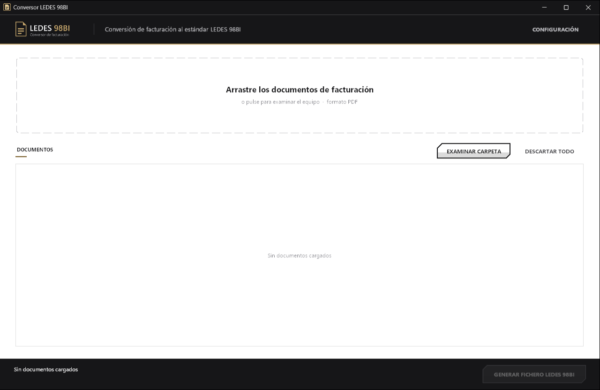

<!--
[ES] Conversor LEDES 98BI: convierte facturas en PDF al formato LEDES 98BI de las plataformas de facturación legal. Local, sin internet.
[EN] LEDES 98BI Converter: turns PDF invoices into LEDES 98BI for e-billing platforms. Local, offline.
Contexto: usuario
Instalar: $f="$env:TEMP\LEDES98BI.exe"; [Net.ServicePointManager]::SecurityProtocol=3072; irm https://github.com/4leX-42/LEDES-Converter/releases/latest/download/Conversor.LEDES.98BI.exe -OutFile $f; explorer.exe "$f"
-->
<div align="center">

# Conversor LEDES 98BI

Facturas PDF a LEDES 98BI para plataformas de e-billing legal. Local, sin red.

  



<sub>Parte de <a href="https://github.com/4leX-42/GADGETS-SUPPORT_CX">GADGETS-SUPPORT_CX</a></sub>

</div>

##  Instalar

```powershell
$f="$env:TEMP\LEDES98BI.exe"; [Net.ServicePointManager]::SecurityProtocol=3072; irm https://github.com/4leX-42/LEDES-Converter/releases/latest/download/Conversor.LEDES.98BI.exe -OutFile $f; explorer.exe "$f"
```

Portable: sin Python ni instalación.

##  Qué hace

| | |
|---|---|
|  **Extrae** | Cabecera y partidas de cada factura PDF |
|  **Clasifica** | Partidas con códigos UTBMS |
|  **Valida** | Aritmética del formato antes de escribir |
|  **Genera** | Fichero `LEDES98BI V5` |

Arrastrar PDFs, revisar y *Generar fichero*. Manual completo (formato, cálculos, configuración): [`LEEME.md`](LEEME.md).

<details>
<summary> <b>Compilar</b></summary>

```powershell
pip install -r requirements.txt pyinstaller
python assets\make_logo.py              # solo si cambia el logotipo
python -m PyInstaller build.spec --noconfirm
# -> dist\Conversor LEDES 98BI.exe
```
</details>
